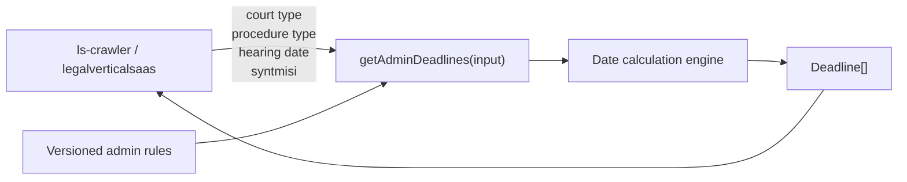

# Administrative Deadline Engine: Visual Guide

## Before and After

```diff
 Consumer
   getAdminDeadlines(input)
    load versioned rules bundled in package
     validate and order rules
     calculate dates
     apply holidays and summer suspension
     attach legislation and calculation details
     return 12 calculated deadlines
```

## Package Boundary



## Ownership

```text
prothesmies package
├── legal rules
├── number of days
├── before/after direction
├── working/full/calendar-day behavior
├── parent deadline chains
├── holidays and summer suspension
├── syntmisi adjustment
└── legislation references

consumer application
├── whether the case category is supported
├── mapping a court to DP_DE
├── filing-date anchor
├── hearing-date anchor
├── deadline persistence
└── calculation_version
```

## Target File Shape

```diff
 src/
 ├── index.ts
-│   # exports only the civil calculator
+│   # exports civil and administrative public APIs
 │
 ├── deadlines-admin.ts
-│   # synchronous orchestration over bundled rules
+│   # synchronous orchestration over bundled rules
 │
+├── rules/
+│   └── rules-admin-diafora-ousias.ts
+│       # 12 active, version-controlled administrative rules
+│
 ├── types.ts
-│   # internal GetDeadlinesInput
+│   # exported GetAdminDeadlinesInput and admin enums
 │
 └── tests/
-    └── deadlines-admin.integration.test.ts
+    └── deadlines-admin.test.ts
+        # deterministic dates, chains, holidays, syntmisi, errors
```

## Public Call

```ts
import {
  getAdminDeadlines,
  CourtType,
  ProcedureType,
  type GetAdminDeadlinesInput,
  type Deadline,
} from "@gsoti/prothesmies";

const input: GetAdminDeadlinesInput = {
  court_type: CourtType.DP_DE,
  procedure_type: ProcedureType.DIAFORA_OUSIAS,
  dikasimos: "2026-11-20",
  syntmisi: false,
};

const deadlines: Deadline[] = getAdminDeadlines(input);
```

## Runtime Flow

```text
getAdminDeadlines(input)
  validate hearing date and enum values
    hearing date must be Monday-Friday
    hearing date must not be a holiday in the package's Greek holiday calendar
  load embedded DIAFORA_OUSIAS rules
  verify rule dependencies
  topologically sort rules

  determine required date range
  load holidays for that range
  calculate summer suspensions

  for each rule
    choose hearing date or calculated parent as reference
    if syntmisi and rule is apopseis_fakelos_dioikisis
      use 8 days
    calculate final date
    attach calculation explanation
    attach legislation

  return calculated deadlines
```

## Verification

The calculator uses versioned rules bundled with the package and returns its calculated deadlines synchronously.

Current verification:

- Generated `dikasimos` values are valid ISO dates, Monday through Friday, and not Greek holidays.
- The rule set is version-controlled and loaded from the package.
- Deterministic tests cover dates, chained rules, holidays, suspension, shortening, and invalid inputs.
- The public output order is stable and covered by the deterministic test suite.
- The normal unit-test suite is deterministic and independent of external services.
- Weekend and Greek-holiday hearing dates are tested separately and must throw `DeadlineCalculationError`.
- Deterministic, independently reviewed examples remain the legal-correctness oracle.

## Deliberately Excluded

```text
getAdminDeadlines()
  ✗ does not inspect katigoria
  ✗ does not inspect application court codes
  ✗ does not query a database
  ✗ does not return katathesi
  ✗ does not return dikasimos as an anchor
  ✗ does not store anything
```

The package release is the hand-off point. Consumers apply their eligibility policy, add anchors, store the deadlines, and record the package version.
